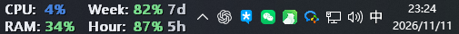
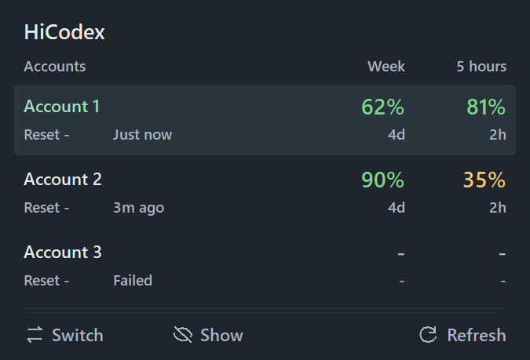
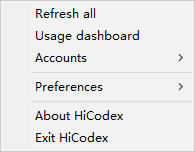

# HiCodex

English · [简体中文](README.zh-CN.md)

A lightweight Windows taskbar utility for Codex usage and account switching.

## Features

- Weekly and five-hour usage for saved accounts in one compact panel.
- Reset counts, refresh status, and account visibility controls.
- Enable Switch, then select an account: quit Codex, switch, and reopen.
- Sign in, import/export JSON, and remove saved accounts.
- English and Simplified Chinese interface.
- Optional CPU/RAM display and taskbar centering with crash recovery.

## Download and use

Download `HiCodex.exe` from [Releases](../../releases), quit any older HiCodex instance, and launch it. Hover over the taskbar meter to view accounts; right-click the meter for account management and preferences.

See [release notes](docs/releases/v0.6.0.md) for version-specific changes.

## Interface and controls

### Taskbar

See the current account's remaining usage and reset times, with optional CPU and memory usage.

### Accounts panel

Hover to compare saved accounts. Enable `Switch`, then select the target account. `Show / Hide` controls identity visibility; `Refresh` updates usage.

### Context menu

Right-click the HiCodex taskbar meter for quick actions.

| Entry | Action |
| --- | --- |
| Refresh all | Refresh usage for all accounts |
| Usage dashboard | Open usage details |
| Accounts | Sign in, import/export JSON, remove accounts |
| Preferences | Startup, CPU/RAM display, taskbar centering, language |
| About HiCodex | View app information |
| Exit HiCodex | Quit HiCodex |

## Privacy and compatibility

Saved credentials are encrypted locally with Windows DPAPI. Exported account JSON contains credentials: keep it private.

Windows x64. Taskbar integration can vary with Windows and Explorer versions.

## Development

See [Contributing](CONTRIBUTING.md) and [Security](SECURITY.md).

## License

[MIT](LICENSE)
