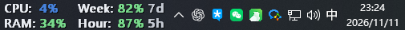
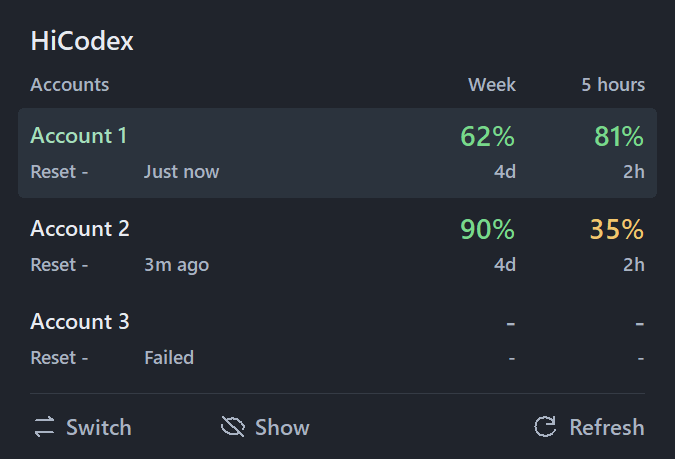
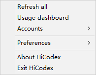

# HiCodex

[English](README.md) · 简体中文

轻量的 Windows Codex 任务栏用量与账号切换工具。

## 功能

- 一个紧凑面板查看各账号的周额度、5 小时额度。
- 展示 Reset 次数、刷新状态，支持隐藏账号。
- 开启 Switch 后点击账号：退出 Codex、切换、自动重新打开。
- 直接登录、JSON 导入导出、删除账号。
- 中英文界面切换。
- 可选 CPU/内存显示、任务栏居中与崩溃恢复。

## 下载与使用

从 [Releases](../../releases) 下载 `HiCodex.exe`，退出旧版 HiCodex 后启动。悬停任务栏小组件查看账号，右键打开账号管理与偏好设置。

版本变更见[发布说明](docs/releases/v0.6.0.zh-CN.md)。

## 界面与操作

### 任务栏

随时查看当前账号的剩余额度与重置时间，可选显示 CPU 和内存占用。

### 账号面板

悬停打开面板，对比各账号额度。点击 `Switch` 开启切换模式，再选择目标账号；`Show / Hide` 控制账号显示，`Refresh` 更新额度情况。

### 右键菜单

右键点击 HiCodex 任务栏小组件，打开快捷操作。

| 入口 | 用途 |
| --- | --- |
| Refresh all | 刷新所有账号额度 |
| Usage dashboard | 打开用量详情 |
| Accounts | 登录、JSON 导入导出、删除账号 |
| Preferences | 开机启动、CPU/内存显示、任务栏居中、界面语言 |
| About HiCodex | 查看程序信息 |
| Exit HiCodex | 退出 HiCodex |

## 隐私与兼容性

账号凭据通过 Windows DPAPI 在本机加密保存。导出的 JSON 含登录凭据，请妥善保管。

适用于 Windows x64，任务栏集成效果可能随 Windows 与 Explorer 版本而变化。

## 开发与许可

[贡献指南](CONTRIBUTING.md) · [安全说明](SECURITY.md) · [MIT](LICENSE)
