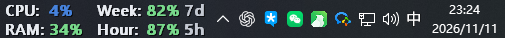
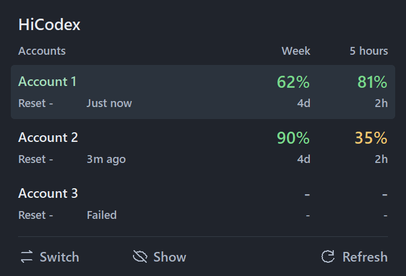
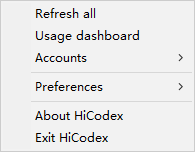

# HiCodex v0.6.0

English · [简体中文](https://github.com/fangzh5/hi-codex/blob/v0.6.0/docs/releases/v0.6.0.zh-CN.md)

## Added and changed

- Compact multi-account panel: Week on the left, 5 hours on the right, reset counts and refresh status.
- SVG icons with text: Switch and Show / Hide on the left, Refresh on the right.
- Arm Switch and select an account to quit, switch, and reopen Codex automatically.
- Account sign-in, JSON import/export and removal; English/Chinese preferences.
- Crash recovery for taskbar centering state.

## Fixed

- Request a real app quit instead of closing windows and waiting for background processes to time out.
- Relaunch through the Windows app identity instead of directly opening the executable.
- Preserve the account list during switching to prevent the legacy panel from flashing.
- Separate panel and taskbar font settings, restoring the original taskbar font.
- Improve local desktop-state preservation during account switching.

## Removed and simplified

- Removed the codex-auth import menu; direct sign-in and JSON import/export remain.
- Removed Recovery / undo-switch entries and the Acrylic taskbar option.
- Omitted Pin controls and removed redundant usage descriptions; shortened status labels.

## Upgrade

Quit the old HiCodex instance and run the new `HiCodex.exe`. No installer required. Account exports contain credentials; do not share them.

## Usage notes

Finish active work before switching. Close other running CLI/IDE clients first. If Codex does not exit in time, choose to wait, cancel, or force close.

## Screenshots

