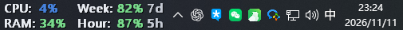
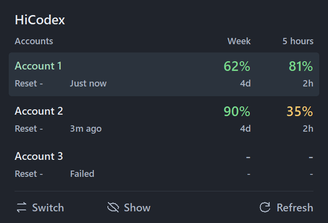
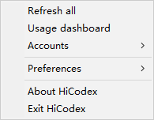

# HiCodex v0.6.0

[English](v0.6.0.md) · 简体中文

## 新增与调整

- 紧凑多账号额度面板：周额度在左、5 小时额度在右，显示 Reset 次数与刷新状态。
- 工具栏采用 SVG 图标与文字；Switch、Show / Hide 靠左，Refresh 靠右。
- 开启 Switch 后选择账号，自动退出、切换并重新打开 Codex。
- 账号管理支持登录、JSON 导入导出及删除账号；新增中英文设置。
- 新增任务栏居中状态的崩溃恢复机制。

## 修复

- 使用真正的退出命令，避免只关闭窗口后等待后台超时。
- 通过 Windows 应用入口重新打开 Codex，修复直接启动 EXE 失败。
- 切换过程中保留账号列表，避免闪现旧版面板。
- 分离面板与任务栏字体设置，恢复任务栏原字体。
- 改进切换账号时的本地桌面状态保留。

## 移除与简化

- 移除 codex-auth 导入菜单，保留直接登录及 JSON 导入导出。
- 移除 Recovery / 撤销切换入口和 Acrylic taskbar 选项。
- 不提供 Pin 控件；删除冗余额度说明文字，简化状态文案。

## 升级

退出旧版 HiCodex 后运行新的 `HiCodex.exe`，无需安装。导出的账号 JSON 含登录凭据，请勿分享。

## 使用提示

切换前请完成正在运行的任务。其他 CLI/IDE 客户端仍在运行时，需先退出；如果 Codex 未能及时退出，面板会提供等待、取消或强制关闭选项。

## 界面截图

